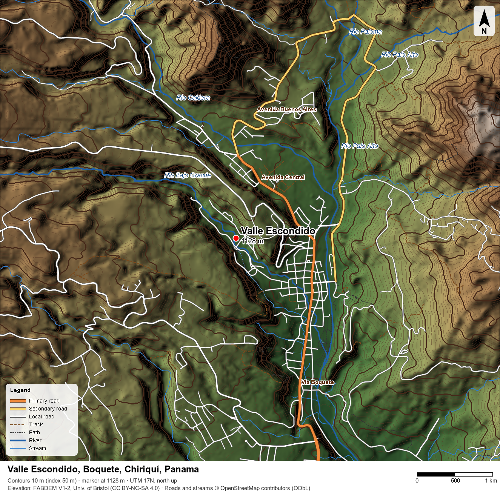

# topod

Proof of concept: a local topographic map (hillshade, elevation tint, 10 m contours, roads and streams)
of Valle Escondido, Boquete, Chiriquí, Panama.
It is separate from the DEM→hex pipeline in the parent directory.



## Usage

```sh
./fetch-inputs.sh       # FABDEM tile + OSM roads/waterways into input/
./valle-escondido.sh    # renders valle-escondido-topo.png; intermediates in work/
```

Needs GDAL (3.x CLI tools), ImageMagick 7 (`magick`) and `python3` (standard library only).

`valle-escondido.sh` takes optional arguments `DEM NODATA OUT CREDIT OSM-LINES`.
To render the JAXA DEM from `../dem` without roads:

```sh
./valle-escondido.sh ../dem/Pma_DEM_30m.tif 32767 aw3d.png "Source: JAXA ALOS AW3D30" ""
```

## Files

| Path | What it is |
| --- | --- |
| `valle-escondido.sh` | Crops and reprojects the DEM (UTM 17N, 5 m), shades, tints, contours, draws the overlay and labels |
| `osm2mvg.py` | Turns OSM lines (GeoJSON in UTM 17N) into ImageMagick MVG draw commands, with labels and a legend |
| `fetch-inputs.sh` | Downloads `input/` |
| `input/N08W083_FABDEM_V1-2.tif` | FABDEM V1-2 1°×1° tile (30 m, bare earth) |
| `input/osm.xml`, `input/lines.geojson` | OSM extract for the map box, raw and converted |
| `valle-escondido-topo.png` | The map |
| `valle-escondido-compare.png` | JAXA AW3D30 (left) vs FABDEM (right), same styling, no roads |

## Data and licences

The scripts are MIT licensed (see [LICENSE](LICENSE)).
The data and the maps made from it carry their own licences:

- **FABDEM V1-2** (University of Bristol): Copernicus GLO-30 with forests and buildings removed.
  CC BY-NC-SA 4.0, so non-commercial use only.
- **OpenStreetMap** roads and waterways: ODbL. The map's credit line is required when sharing.
- **JAXA ALOS AW3D30** (`../dem/Pma_DEM_30m.tif`): a surface model that includes the tree canopy.
  Across this map box it is on average 8 m higher than FABDEM (standard deviation 5 m).

All sources are 30 m, so the 5 m output pixels are smoother, not more detailed.
OSM has no boundary for Valle Escondido, so the marker is the published point (8.78157° N, 82.44169° W).
